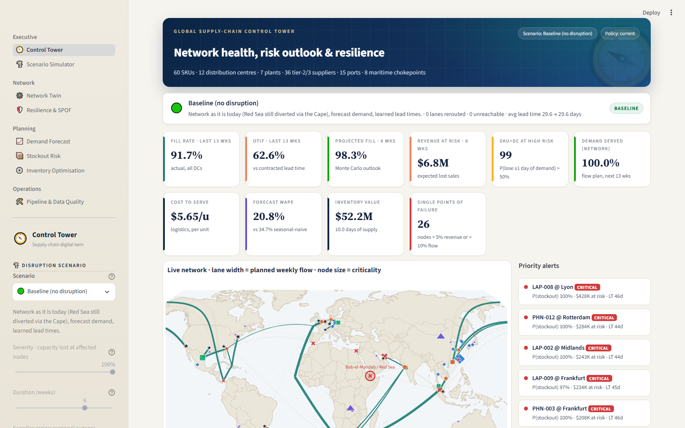
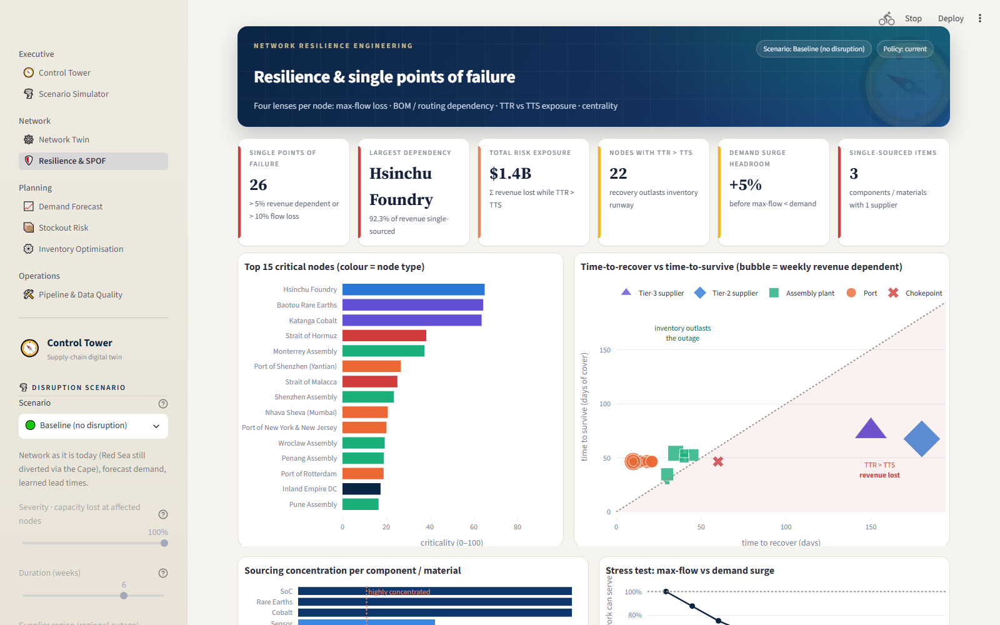
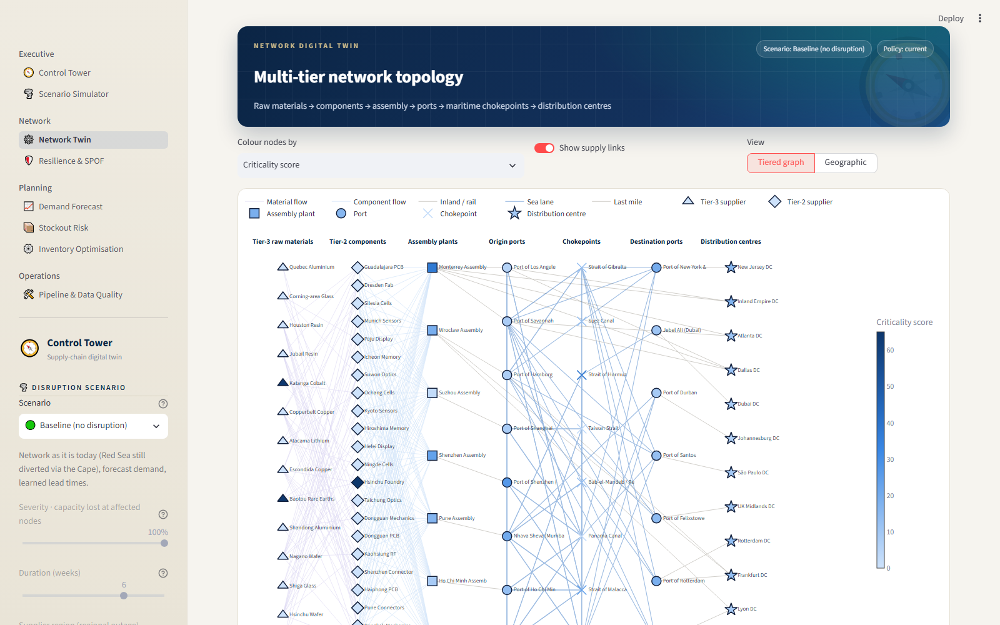
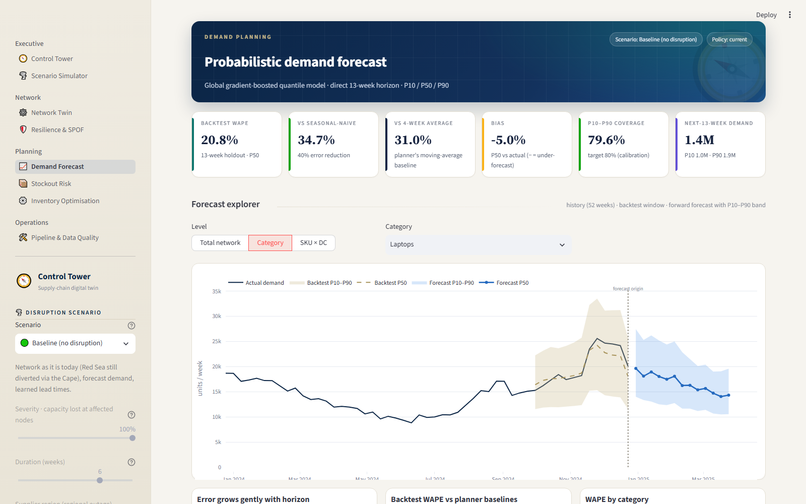
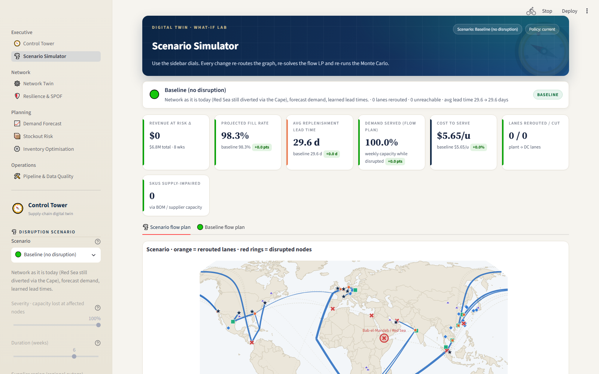

# Supply-Chain Digital Twin & Inventory Optimisation


A digital twin of a five-tier global electronics supply chain. It models the network as a graph, forecasts
demand with uncertainty bands, finds single points of failure, optimises safety stock, and lets you test
"what if" disruptions from a Streamlit dashboard.

   
  

## The business problem
In 2023–24, supply chains faced a Panama Canal drought, the Red Sea crisis, typhoons, port strikes and a
foundry fire. Most planning tools showed that lead times went up. They could not answer:
- Which lanes, products and customers will be hit next?
- Where does the network have no backup?
- What should change in inventory policy before the next shock?

## What it does
- **Network model.** 60 SKUs, 36 suppliers (two tiers), 7 plants, 15 ports, 8 real maritime chokepoints
  (Suez, Panama, Taiwan Strait, Hormuz and more) and 12 distribution centres (DCs). Closing a chokepoint
  removes a graph node, and rerouting follows from the graph.
- **ELT and warehouse.** An 11-task pipeline (Airflow, or a local runner) extracts simulated ERP/TMS/WMS data,
  loads it into DuckDB, runs a data-quality gate, then builds SQL staging views and marts.
- **Forecasting.** One global scikit-learn gradient-boosting model (`HistGradientBoostingRegressor`, quantile
  loss) per quantile gives P10/P50/P90 weekly demand for 13 weeks ahead, for all 720 SKU×DC series.
- **Resilience and risk.** NetworkX scores every node on flow lost, bill-of-materials dependency, time-to-recover
  vs time-to-survive (TTR vs TTS) and betweenness. A Monte Carlo engine estimates 8-week stockout risk.
- **Optimisation.** SciPy SLSQP sets safety stock within each DC's space. A HiGHS linear program plans flow.
- **Scenarios.** Nine presets plus a custom node outage. Each re-runs the whole twin in about 4 seconds.
- **Dashboard.** An 8-page Streamlit control tower.

History covers two simulated years (2023–24): 524k daily demand rows, 65k shipments and eight disruptions
based on real events. The baseline is the network as it is today, with the Red Sea crisis still active.

## Quick start
```bash
pip install -r requirements.txt
python -m src.pipeline              # full pipeline locally, about 5 min (mostly model training)
streamlit run dashboard/app.py      # http://localhost:8501
python -m pytest -q                 # 16 tests
# Optional: Apache Airflow in Docker (Airflow does not run on native Windows); UI at http://localhost:8080
docker compose up airflow-init && docker compose up -d
```
Rerun part of the pipeline with `python -m src.pipeline --from build_marts` or `--only train_and_forecast`.

## Dashboard pages
A sidebar on every page sets the scenario, its severity and duration, shocks, inventory policy and filters.

| Page | What it shows |
|---|---|
| Control Tower | KPIs with scenario deltas, live world map, alerts, two-year service trend |
| Scenario Simulator | Before/after KPIs, rerouted lanes, risk by DC, a league table of all scenarios |
| Network Twin | Tiered network graph; click a node to see its risk and simulate its outage |
| Resilience & SPOF | Criticality ranking, TTR vs TTS chart, concentration, stress test, supplier scorecard |
| Demand Forecast | P10–P90 fan charts and accuracy vs baselines |
| Stockout Risk | SKU×DC risk heatmap and projected on-hand per series |
| Inventory Optimisation | Efficient frontier, safety-factor changes, policy download |
| Pipeline & DQ | Task status and timings, data-quality results, model registry |

| | |
|---|---|
|  |  |
|  |  |
|  | |

## Results

**Forecasting** (13-week time-based holdout)

| Model | WAPE |
|---|---|
| Seasonal naive (same week last year) | 34.7% |
| 4-week moving average | 31.0% |
| **Global quantile GBM** | **20.8%** (−40% vs seasonal naive) |

Bias is −5.0%. The P10–P90 band covers 79.6% of actuals, against an 80% target.

**Resilience.** 26 single points of failure (> 5% of revenue with no alternative, or > 10% flow loss).

| Node | Revenue dependent | TTR vs TTS | Risk exposure |
|---|---|---|---|
| Hsinchu Foundry (SoC, Taiwan) | 92% | 180 d vs 68 d | ≈ $600M |
| Baotou rare earths (China) | 92% | 150 d vs 75 d | ≈ $403M |
| Katanga cobalt (DR Congo) | 90% | 150 d vs 75 d | ≈ $393M |

The network can absorb only about +5% extra demand. The binding constraint is assembly capacity, not shipping.

**Scenarios** (8-week outlook, 100% severity for 6 weeks, vs the as-is baseline)

| Scenario | Δ revenue at risk | Fill | Avg lead time | Demand servable |
|---|---|---|---|---|
| Baseline (Red Sea via Cape) | — | 98.3% | 29.6 d | 100% |
| Red Sea reopens (upside) | ≈ $0 within 8 wks | 98.3% | 26.4 d | 100% |
| Panama Canal drought | +$1.9M | 97.8% | 30.3 d | 100% |
| Demand surge +30% | +$7.6M | 97.2% | 29.6 d | 80.9% |
| Strait of Hormuz closure | +$10.6M | 94.8% | 33.1 d | 94.1% |
| Shanghai port lockdown | +$18.6M | 94.8% | 31.9 d | 98.1% |
| US West Coast port strike | +$24.8M | 93.4% | 33.0 d | 100% |
| Taiwan Strait blockade | +$43.4M | 83.5% | 40.5 d | 19.6% |
| Hsinchu foundry outage alone | +$43.4M | 83.5% | 39.6 d | 19.6% |

Key finding: losing one Taiwanese foundry does as much damage as blockading the whole strait. The weak point
is silicon, not shipping. A second SoC source is worth more than any logistics plan.

**Inventory optimisation** (all 12 DCs solved to optimality)
- Annual holding + shortage cost falls 15.9% ($14.4M → $12.1M); fill rises from 98.6% to 99.2% in the same space.
- Reallocating today's budget alone lifts fill to 99.24%, with no extra inventory.
- Service shifts to compact, high-margin phones and wearables (z ≈ 2.1) from bulky smart-home devices (z ≈ 1.7).

## Project structure
```
dags/supply_chain_digital_twin.py           Airflow DAG, built from the task registry
src/
  config.py, network.py, routing.py         master data, network graph, routing
  generate.py                               history simulator (extract step)
  warehouse.py, quality.py                  DuckDB layers, data-quality gate
  features.py, forecast.py                  feature store, quantile forecasting
  graph_analytics.py                        single points of failure, max-flow, TTR/TTS
  scenarios.py, risk.py, optimize.py        scenarios + flow LP, Monte Carlo, SLSQP
  twin.py, pipeline.py                      twin engine, task registry and local runner
sql/staging/, sql/marts/                    SQL models
dashboard/app.py, components/, views/       8-page Streamlit dashboard
docs/ARCHITECTURE.md, DATA_DICTIONARY.md, screenshots/
tests/                                      16 tests (unit, LP, Monte Carlo, SLSQP, DAG wiring, warehouse)
```
More detail: [Architecture](docs/ARCHITECTURE.md) · [Data dictionary](docs/DATA_DICTIONARY.md).

## Limitations
- All data is simulated. Results show what the method can do, not facts about a real company.
- The warehouse runs on DuckDB. The SQL is written to also suit Snowflake, but no Snowflake connection is
  included or tested.
- Forecasts and risk depend on the simulator's assumptions about lead times, demand and disruptions.
- Safety stock is optimised one DC at a time, not across the whole network at once.

---
**Series:** [2023 · E-commerce analytics (Power BI)](../project1_ecommerce_analytics) → [2024 · SaaS revenue & churn (dbt + Tableau)](../project2_saas_churn_analytics)
→ **2025 · Supply-chain digital twin** → [2026 · Real-time fraud intelligence](../project4_fraud_detection)

*Synthetic data. Company, supplier and facility names are illustrative. Geography and disruption events are
based on public 2023–24 events.*
