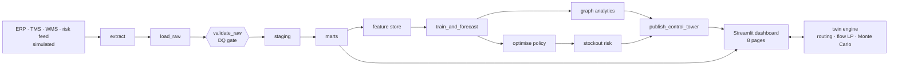

# Architecture

## System view

The pipeline has 11 tasks defined once in `src/pipeline.TASKS`. Airflow runs them daily at 04:00 UTC; the
local runner (`python -m src.pipeline`) runs the same registry.

Warehouse schemas (DuckDB): `raw` → `staging` → `marts` → `ml`, plus `ops` for task runs, DQ results and the
model registry. See [DATA_DICTIONARY.md](DATA_DICTIONARY.md).

## Twin engine (`src/twin.py`)
1. Scenario settings (scenario, severity, duration, lead-time ×, demand shock, region) close, slow or
   throttle nodes.
2. Routing finds the best path from each plant to each DC (Dijkstra). Supply availability comes from the
   bill of materials and supplier capacity.
3. A SciPy `linprog` (HiGHS) flow plan gives cost to serve, utilisation and unmet demand.
4. A Monte Carlo run over 8 weeks uses the P10/P50/P90 forecast, the open pipeline and the chosen safety-stock
   policy to give stockout probability, fill and revenue at risk.

A full run over all 720 SKU×DC series takes about 4 seconds. The dashboard caches results by settings.

## Runtime (laptop, full pipeline from scratch)
| Step | Time |
|---|---|
| extract + load + DQ + SQL | ~15 s |
| feature store | ~5 s |
| forecast (backtest + production, 6 model fits) | ~4.5 min |
| graph analytics | ~6 s |
| optimisation (12 SLSQP + frontier) | ~3 s |
| Monte Carlo outlook (2 policies) | ~7 s |

## Key design decisions
1. **Graph-native network model.** Suppliers, plants, ports, chokepoints and DCs are graph nodes, and sea routes
   are chains of legs. A disruption is just a removed or slowed node, so rerouting follows from the graph.
2. **DuckDB locally, Snowflake in production.** DuckDB runs locally and in CI with no server. The SQL models use
   portable ANSI SQL so they could move to Snowflake (not connected or tested here).
3. **Global direct quantile forecasting.** One model across all series, with the forecast horizon as a feature
   (no recursive error build-up) and separate P10/P50/P90 models, so risk gets a distribution, not a point.
4. **Four-lens resilience scoring.** Flow loss, BOM dependency, TTR vs TTS exposure and betweenness are combined
   on magnitudes, not ranks, so single-source suppliers are not hidden.
5. **Optimisation formulation.** Safety stock is chosen per SKU with SLSQP to minimise holding plus shortage cost
   within each DC's storage space. Network flow is a separate min-cost linear program.
6. **Single task registry for Airflow.** The DAG, the local runner and the tests all read the same task list,
   so code, dependencies and retries are defined once.

## Security and governance
- No personal data: only aggregate operational data (SKU × DC × day).
- The dashboard opens DuckDB read-only.
- Every model version and task run is logged in `ops` for audit.
- Data-quality failures block publication. Warnings show on the Pipeline & DQ page.
